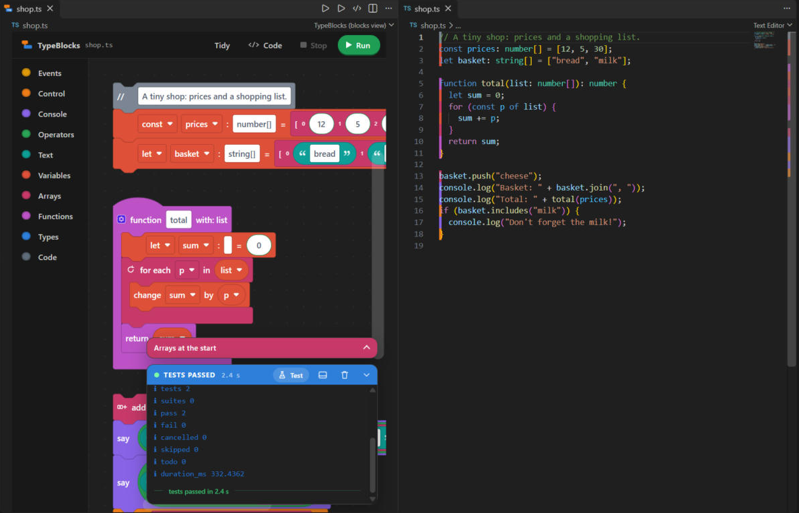

# TypeBlocks

**See and edit any TypeScript file as Scratch-style drag-and-drop blocks, right inside VS Code.**
No extra files: the blocks are just another view of your `.ts` file, and every change is saved as normal TypeScript.



**📘 Guide: [English](https://lukasvitek67.github.io/typeblocks/guide/en/) · [Česky](https://lukasvitek67.github.io/typeblocks/guide/)** - how every block works, with live examples you can run. Also inside VS Code: the **?** button in the blocks editor.

## Install (one line)

**Windows** - paste into PowerShell:

```powershell
irm https://raw.githubusercontent.com/LukasVitek67/typeblocks/main/install.ps1 | iex
```

**macOS / Linux** - paste into a terminal:

```bash
curl -fsSL https://raw.githubusercontent.com/LukasVitek67/typeblocks/main/install.sh | sh
```

**By hand:** download `typeblocks-x.y.z.vsix` from [Releases](https://github.com/LukasVitek67/typeblocks/releases/latest), then in VS Code: *Extensions* -> `...` -> *Install from VSIX...*

Needs VS Code 1.90 or newer. Nothing else - Run uses the Node.js that is built into VS Code.

## Use

1. Open a `.ts` file as usual.
2. Click the **blocks button** in the editor's top-right toolbar (or right-click the file -> *Open as Blocks*).
3. Drag, drop, edit. The code next to the blocks changes live; **Ctrl+S** saves the `.ts` file as always.
4. Click **Code** to go back to the normal text editor.

**Run** compiles the file and runs it in the **console** at the bottom of the blocks editor (no Node install needed): colored output, a live timer, and a line to type answers for `ask` blocks. Drag its edge to resize, double-click the header to fold it.

The layout button in the console header puts it **at the bottom (full width)**, **on the right (full height)**, or as a **card above / below the Arrays card**. The **Test** button runs `npm test` from the nearest `package.json` that has a `test` script, right in the console.

### Finding blocks

- **Search** above the categories: type `.filter`, `pole`, `random`, ... - matching blocks appear on the left, and the suggestion list puts the one you pick right where it makes sense (under the selected block or into its empty hole).
- **Right-click a block -> Show what fits here**: the left side shows only blocks that fit the empty slot you clicked next to.
- **One click** on a block on the left puts it in; dragging works as usual.
- **Types are picked from a list** (text, number, yes/no, arrays, your own types) - never typed by hand.

### A guide for every block

Right-click **any** block (also one on the left side) -> **What does this block do?** A window explains it in plain words, shows a small example you can change, the TypeScript it makes (live, the lines of the selected block light up) and a **Run** button - the example runs right in the window. Every block type has one (tested).

### Recipes

The **Recipes** category at the top opens ready-made little programs: arrays (make, go through, filter, map, add up, find the biggest), math (calculator, what is calculated first, even/odd, average, dice, ask for a number) and functions that calculate (add, area, is it even, average, °C to °F). Every recipe explains in plain words what it does, shows its blocks and its TypeScript, and gives a *Try:* idea. **Insert** puts it under your program.

## What becomes blocks

- variables (`let/const name: type = value`), `x = ...`, `x += ...`, `x++`
- `if / else if / else`, `while`, `for (let i = 0; i < n; i++)` (repeat), `for (let i = a; i <= b; i++)` (count), `for (const x of list)`, `break`, `continue`
- functions with typed parameters and return types, calls, `return`
- math, comparisons, `&&` `||` `!`, ternary, `typeof`, `as`
- text: `+`, `.length`, `.includes`, `.toUpperCase()`, `.split()`, `String()`, `Number()`
- objects `{ name: value }`, properties (`order.count`, `order.paid = true`), `type` / `interface` shapes, `export`
- comments (`// ...`, also at the end of a line) and blank lines are kept
- **calling anything**: `Math.floor(x)`, `parseFloat(t)`, `askNumber(...)` from another file, a function parameter - and **methods** of any value: `text.slice(0, 3)`, `.padStart`, `.charCodeAt`, `set.has(x)`, `map.get(k)` ... (picked from an explained list)
- `console.log(a, b, c)`, template text `` `Hi ${name}` ``, `new Set / Map / Date / Error`, arrow functions `(a, b) => a - b`, `x[key]`, `+=` / `++` on anything
- `try / catch`, `throw`, `do ... while`, the classic `for (let i = 0; i < list.length; i++)`, `for (const [key, value] of map)`
- `undefined`, `null`, `NaN`, `this`, regular expressions `/\d+/`, `...spread`, `await`, `import { ... } from "..."`
- types: `type Gender = "male" | "female"`, `type Student = Human & { ... }`, `interface X extends Y`, optional fields and methods (`name(): string`), objects with methods (`name() { return this.givenName; }`)

Checked against real school assignments (strings, regex, Morse code, collections with Map / Set / Record, functions, objects with methods): every one of their files becomes blocks.

### Arrays - made easy

- an array literal is a row of numbered slots `[ 0:(a) 1:(b) ]` with **+ / -** buttons
- plain-English blocks with icons: *add to the end / start*, *insert at index*, *set item at index*, *remove item at index*, *remove the last / first item*, *sort / reverse*, *item at index*, *last item*, *length*, *contains*, *index of*, *join with*, *for each item in*
- **array methods** as plain-English blocks: `.map` (*make a new array: each item becomes ...*), `.filter` (*keep only each item where ...*), `.some` / `.every` (*is there any / is every ...?*), `.find` / `.findIndex`, `.reduce` (*add up ... starting from ...*), `.forEach` - chains like `list.filter(...).reduce(...)` work too
- the **Arrays** panel shows every array you create as a row of boxes with its indexes
- indexes start at 0, exactly like TypeScript

### Everything else

Classes and the few other things without a block are shown as grey **TS code** blocks with the original text (click the pencil to edit). Nothing is ever lost.

The file keeps its own style: indentation (2 or 4 spaces, tabs), quote style, comments, blank lines and how method chains are split. Parts that became blocks always end with `;`.

## Languages

Blocks, console, dialogs and the guide come in **English and Czech**. By default TypeBlocks follows the VS Code display language; change it in Settings -> `typeblocks.language` (auto / cs / en). The code is always plain TypeScript.

## Updates

TypeBlocks updates itself from GitHub Releases: it checks at start-up (at most every 6 hours), downloads the new `.vsix`, **verifies its SHA-256 checksum** against the one GitHub published, installs it and asks you to reload. If a release has no checksum, nothing is installed automatically. Change this with `typeblocks.autoUpdate` (`auto` / `ask` / `off`) or run **TypeBlocks: Check for Updates**.

## Settings

| Setting | Default | |
|---|---|---|
| `typeblocks.openTsBeside` | `true` | also show the code next to the blocks |
| `typeblocks.colorStripes` | `true` | color each code line like the block that made it |
| `typeblocks.language` | `auto` | `auto` (follow VS Code) / `cs` / `en` |
| `typeblocks.autoUpdate` | `auto` | `auto` = install new versions by itself, `ask` = ask first, `off` |
| `typeblocks.runIn` | `panel` | `panel` = built-in console, `terminal` = a VS Code terminal |
| `typeblocks.nodePath` | `""` | use your own `node` for Run |

## Develop

```bash
npm install
npm run build      # bundles + browser preview (preview/index.html)
npm test           # round trips (stable, tsc --strict, runs), updater, guide examples, translations
npm run package    # -> typeblocks-x.y.z.vsix
```

Built on [Blockly](https://github.com/google/blockly) (Apache-2.0) and the TypeScript compiler API.
